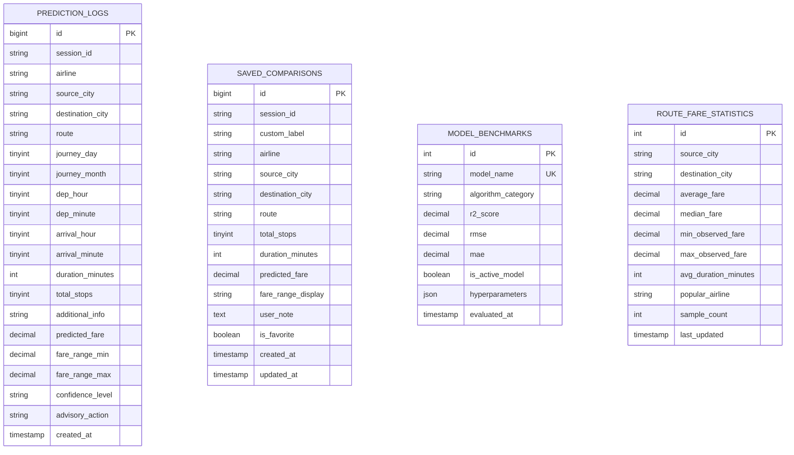

# 🗄️ Database Architecture: Airfare Price Estimation & Pattern Analysis

This directory contains the complete database designs for **both MySQL and MongoDB**, specifically tailored for the **Airfare Price Estimation and Fare Pattern Analysis** project.

---

## 📌 Context: Why These Tables/Collections Exist (Without Login/Registration)

Even though the project has **no user authentication (no login or registration page)**, a production-grade machine learning web application requires a database layer to satisfy full-stack criteria and problem statement requirements:

1. **Prediction Logging (`prediction_logs`)**:
   * Logs every fare inference request made through the API or Web UI.
   * Enables tracking of popular origin-destination queries, searched airlines, duration trends, and predicted prices.
2. **Saved Flight Comparisons (`saved_comparisons`)**:
   * Enables users to bookmark flight estimates and compare options side-by-side without needing an account (using an anonymous browser `session_id`).
   * Satisfies complete **CRUD** requirements (Create bookmark, Read list, Update custom notes, Delete comparison).
3. **ML Model Performance Benchmarks (`model_benchmarks`)**:
   * Directly implements **Step 8 of the Problem Statement** ("Compare regression algorithms").
   * Stores $R^2$ scores, RMSE, and MAE across Linear Regression, Decision Tree, Random Forest, and XGBoost to feed dashboard charts.
4. **Route Fare Patterns (`route_fare_statistics`)**:
   * Stores pre-computed aggregate baseline patterns (average fare, price ranges, median durations) derived from the 10,683 training flight records.

---

## 🏛️ Directory Structure

```
database/
├── README.md                      # Complete architecture and execution guide
├── mysql/
│   ├── 01_schema.sql              # Relational DDL (tables, indexes, views)
│   ├── 02_seed_data.sql           # Initial dataset benchmarks and sample logs
│   └── 03_analytics_queries.sql   # SQL queries for viva & analytical insights
└── mongodb/
    ├── 01_init_mongo.js           # Mongo collections with JSON schema validation
    ├── 02_seed_data.js            # Realistic seed documents
    └── 03_aggregation_queries.js  # Aggregation pipelines matching problem statement
```

---

## 📊 1. MySQL Relational Schema & ER Diagram

### Entity-Relationship (ER) Diagram



### How to Run in MySQL

#### Option A: Command Line (CLI)
```bash
# 1. Login to MySQL and create schema
mysql -u root -p < database/mysql/01_schema.sql

# 2. Insert sample seed data
mysql -u root -p < database/mysql/02_seed_data.sql

# 3. Run analytical queries
mysql -u root -p < database/mysql/03_analytics_queries.sql
```

#### Option B: MySQL Workbench or phpMyAdmin
1. Open MySQL Workbench.
2. Open and execute `01_schema.sql` (click the lightning bolt icon ⚡).
3. Open and execute `02_seed_data.sql`.
4. Open `03_analytics_queries.sql` to inspect or run queries individually.

---

## 🍃 2. MongoDB Document Schema

### Document Mapping

#### Collection: `prediction_logs`
```json
{
  "_id": ObjectId("673dfa10b48e230018a10001"),
  "session_id": "sess-demo-849201",
  "airline": "IndiGo",
  "source_city": "Delhi",
  "destination_city": "Cochin",
  "route": "DEL → BOM → COK",
  "journey_date": "2024-05-25",
  "duration_minutes": 375,
  "total_stops": 1,
  "predicted_fare": 6450.00,
  "fare_range": { "min": 5920.00, "max": 7150.00 },
  "confidence": "High",
  "advisory": {
    "action": "BUY NOW",
    "headline": "Urgent Booking Window"
  },
  "created_at": ISODate("2024-11-20T10:30:00Z")
}
```

#### Collection: `model_benchmarks`
```json
{
  "_id": ObjectId("673dfa10b48e230018a10002"),
  "model_name": "Random Forest Regressor",
  "algorithm_category": "Tree Ensemble (Bagging)",
  "r2_score": 0.8842,
  "rmse": 1640.25,
  "mae": 1120.10,
  "is_active_model": true,
  "hyperparameters": {
    "n_estimators": 100,
    "max_depth": 25,
    "min_samples_split": 5
  },
  "evaluated_at": ISODate("2024-11-20T10:00:00Z")
}
```

### How to Run in MongoDB

#### Option A: MongoDB Shell (`mongosh`)
```bash
# 1. Initialize schema validators & indexes
mongosh < database/mongodb/01_init_mongo.js

# 2. Seed database
mongosh < database/mongodb/02_seed_data.js

# 3. Run aggregation pipelines
mongosh < database/mongodb/03_aggregation_queries.js
```

#### Option B: MongoDB Compass / Atlas GUI
1. Connect MongoDB Compass to your local instance (`mongodb://localhost:27017`) or Atlas connection string.
2. Select database `airfare_prediction_db`.
3. Open `_mongosh` terminal at the bottom of MongoDB Compass and execute the scripts, or view the visual documents and schema validator tab.

---

## ⚖️ 3. MySQL vs. MongoDB: Comparison for This Project

| Feature / Criteria | MySQL (Relational) | MongoDB (Document / NoSQL) |
| :--- | :--- | :--- |
| **Data Format Fit** | Requires mapping JSON payloads to relational columns. | **Native JSON/BSON**: FastAPI dictionaries and frontend payloads save directly. |
| **Setup & Cloud Hosting** | Requires running local service or paid cloud SQL instance. | **Zero local install**: Free MongoDB Atlas cluster (`mongodb+srv://...`) takes 2 minutes. |
| **Authentication Needs** | Best when tables have foreign key cascades (`Users` $\rightarrow$ `Bookings`). Since this project has **no login**, relational constraints are not strictly necessary. | **Ideal**: Collections are autonomous; documents store self-contained prediction sessions. |
| **Schema Evolution** | `ALTER TABLE` needed if new ML features or hyperparameters are added. | **Schema flexibility**: Easily logs dynamic ML tree percentiles, explanations, or route variations. |
| **Academic & Viva Suitability** | High: Professors often look for ER diagrams, normalization (3NF), and SQL queries. | High: Demonstrates modern full-stack NoSQL practices for ML applications. |

---

## 💡 Recommendation for Your Final Submission

* **If your evaluation panel expects traditional SQL / ER diagrams**: Use the **MySQL** files (`database/mysql/`). You have the full ER diagram, normalized tables, and analytical SQL queries ready to present.
* **If your priority is fast setup and seamless ML integration**: Use **MongoDB** (`database/mongodb/`). It naturally accepts JSON responses from the FastAPI `/predict` endpoint.
